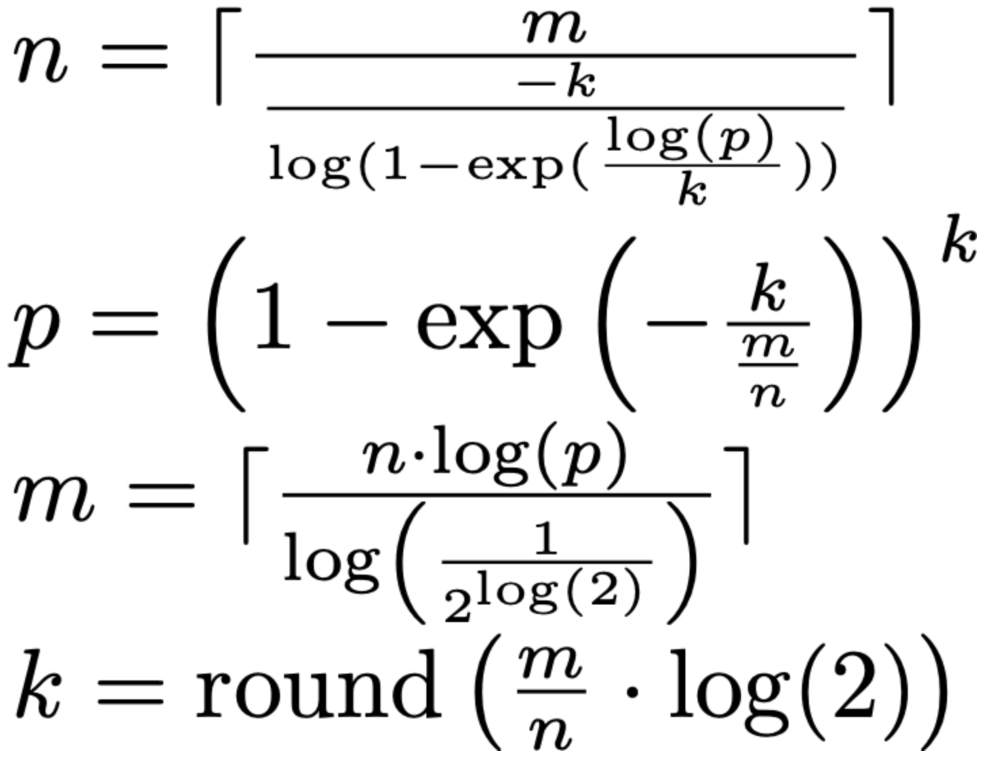

# Bloom Filter Overview
A Bloom filter is a probabilistic set membership structure that tracks whether elements have been seen. It guarantees no false negatives while allowing a tunable false positive rate. This script ingests user IDs, hashes each with a double-hashing scheme derived from SHA-256, and flips the corresponding bits in a large bytearray to record check-ins.

## Mathematical Basis


123a: already present
456fish: checked in
```

